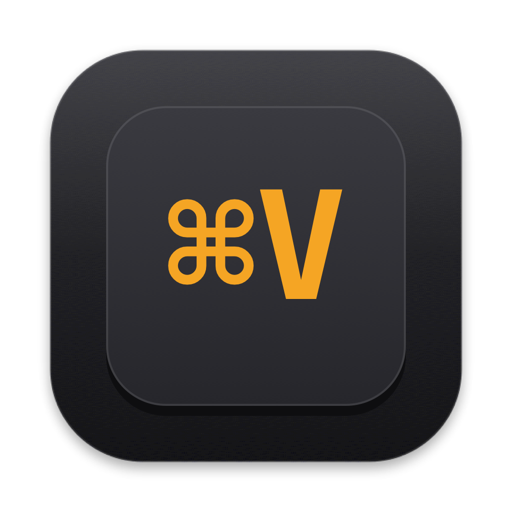

<p align="center">
  
</p>

<h1 align="center">PasteLoop</h1>

A fast, local-first clipboard manager for macOS, written in Rust. Everything you copy lands in
a strip of cards at the bottom of the screen, one keystroke away. No subscription, no account,
no cloud: your history is a plain SQLite file you can script.

- Menu-bar app, no Dock icon. Shift-Cmd-V shows the bar over any app without taking focus
  from it.
- Captures text (with rich formatting), links, images, files, and colors. Password managers
  that mark clipboard contents as concealed are skipped.
- Return pastes into the app you were using, text without its formatting. Shift-Return keeps
  the formatting, and pastes images and files as their paths. Cmd-1 to Cmd-9
  paste by number (Quick Paste).
- Search as you type across titles, text, link titles, app names, and text recognized inside
  images (on-device Vision OCR). Filter by type, app, date, and collection with chips.
- Collections: named, colored, reorderable lists. Add a card from its context menu or drag it
  onto a tab. Items in a collection never expire.
- Paste Queue (Shift-Cmd-C): copy several things, then each Cmd-V in any app pastes the next.
- Preview (Space) for every kind, image and text files included. Rename, edit, create text
  items, delete with undo, drag cards into other apps.
- Keep history from one day to forever, pause capture, ignore applications. The bar is hidden
  from screen sharing by default.
- Optional backup to iCloud Drive. A new Mac, or this one after reinstalling macOS, restores
  your history and settings automatically.
- A `pasteloop` command line for scripts: search, get, recent, add, export.

Built with [GPUI](https://gpui.rs), the UI framework of the Zed editor, and the `objc2`
bindings. No Swift, no web view.

## Install

Requires an Apple Silicon Mac with macOS 15 or later.

1. Download `PasteLoop-<version>-arm64.zip` from
   [Releases](https://github.com/initmaks/pasteloop/releases), unzip it, and move
   `PasteLoop.app` to `/Applications`.
2. The release is not notarized yet, so macOS refuses the first launch. Open it once, then go
   to System Settings → Privacy & Security and click **Open Anyway** next to the PasteLoop
   message. Or clear the download flag from a terminal:
   ```sh
   xattr -dr com.apple.quarantine /Applications/PasteLoop.app
   ```
3. PasteLoop needs Accessibility permission (System Settings → Privacy & Security →
   Accessibility) to press Cmd-V for you, and asks each time you paste until it has it. Choose
   Copy Only to paste yourself this time, or Don't Ask Again to stop the reminder (Settings →
   General turns it back on). macOS only honors the permission for a
   process that had it when it launched, so PasteLoop offers to relaunch itself after you grant
   it. Each new version is a new signature to macOS: after an update, remove PasteLoop from the
   Accessibility list and add it again.

PasteLoop offers to start at login on its first launch; change that later in Settings.

## Coming from Paste?

Settings → Migration imports text, link, and color history and your pinboards from the Paste
app, keeping their dates. Both apps use Shift-Cmd-V by default, so quit Paste or change one of
the shortcuts.

PasteLoop is an independent project, not affiliated with or endorsed by Paste or its
developers. The name appears here only to identify the app PasteLoop can import from.

## Keyboard

| Action | Keys |
|---|---|
| Show / hide the bar | Shift-Cmd-V (configurable) |
| Paste Queue | Shift-Cmd-C (configurable) |
| Move selection | Left / Right; Up, Home, or Cmd-Up for the first card; Cmd-Down for the last |
| Extend selection | Shift-Left / Shift-Right, Cmd-A for all |
| Paste (text without formatting) | Return |
| Paste text with formatting, images and files as paths | Shift-Return |
| Quick Paste | Cmd-1 … Cmd-9 (add Shift for formatting or paths) |
| Copy without pasting | Cmd-C |
| Preview | Space |
| Open link or file | Cmd-O |
| Rename, edit, new text item | Cmd-R, Cmd-E, Cmd-N |
| Delete, undo | Delete, Cmd-Z |
| Search, filters | Type anywhere; Cmd-F focuses, Cmd-F again opens filters; Tab accepts a chip |
| Show a search result in its list | Cmd-G |
| New collection, switch lists | Shift-Cmd-N, Cmd-Left / Cmd-Right |
| Pause capture | Cmd-T |
| Settings, quit | Cmd-, and Cmd-Q |

Reopening the bar within a minute of dismissing it returns to the same list, search, and card.
After a paste, or a minute later, it opens on the newest card.

## Command line

The app binary doubles as a command-line tool:

```sh
alias pasteloop=/Applications/PasteLoop.app/Contents/MacOS/pasteloop
pasteloop recent 10
pasteloop search "meeting notes" --kind text --limit 20
pasteloop get 42
pasteloop add --text "hello"
pasteloop add --file ./report.pdf
pasteloop export --json backup.json
pasteloop stats
```

The database is plain SQLite (`pasteloop.sqlite`, WAL mode, FTS5 index) and safe to read while
the app runs; the app picks up writes from the CLI within two seconds.

## Where things live

| What | Where |
|---|---|
| Database, blobs, thumbnails, `settings.json` | `~/Library/Application Support/PasteLoop/` |
| Log | `~/Library/Logs/PasteLoop/pasteloop.log` |
| Files handed to other apps (images as files, plain-text image paths) | `~/Library/Caches/PasteLoop/` |
| Backup, when turned on | `iCloud Drive/PasteLoop/<this Mac's name>/` |

Set `PASTELOOP_DATA_DIR` to use another data directory.

## Privacy

Everything stays on your Mac unless you turn on one of two things, both off until you choose:
link previews, and the iCloud Drive backup. PasteLoop asks about the backup once, on first
launch. The backup leaves out deleted items, and items you delete leave it within minutes.
iCloud Drive is encrypted, but Apple holds the keys unless you turn on Advanced Data
Protection for your Apple Account. Clipboard contents are never logged. Concealed and transient pasteboard entries (the convention password
managers follow) are ignored, and you can ignore whole applications. The bar is excluded from
screen sharing and screenshots unless you turn that off.

## Build from source

Needs Rust (stable) and the Xcode Command Line Tools.

```sh
git clone https://github.com/initmaks/pasteloop
cd pasteloop
cargo install just
just bundle                     # release build, then dist/PasteLoop.app
open dist/PasteLoop.app
```

See [CONTRIBUTING.md](CONTRIBUTING.md) for development and
[docs/architecture.md](docs/architecture.md) for how it works.

## License

MIT. See [LICENSE](LICENSE).
